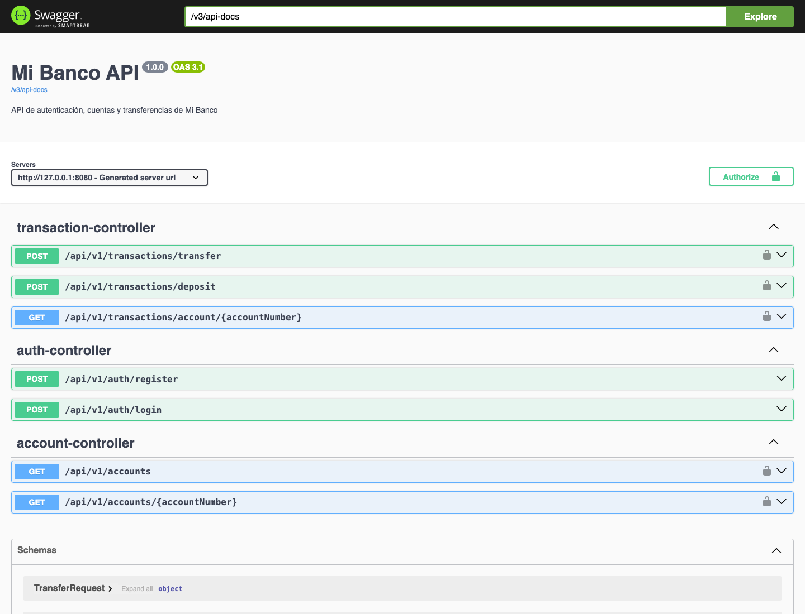
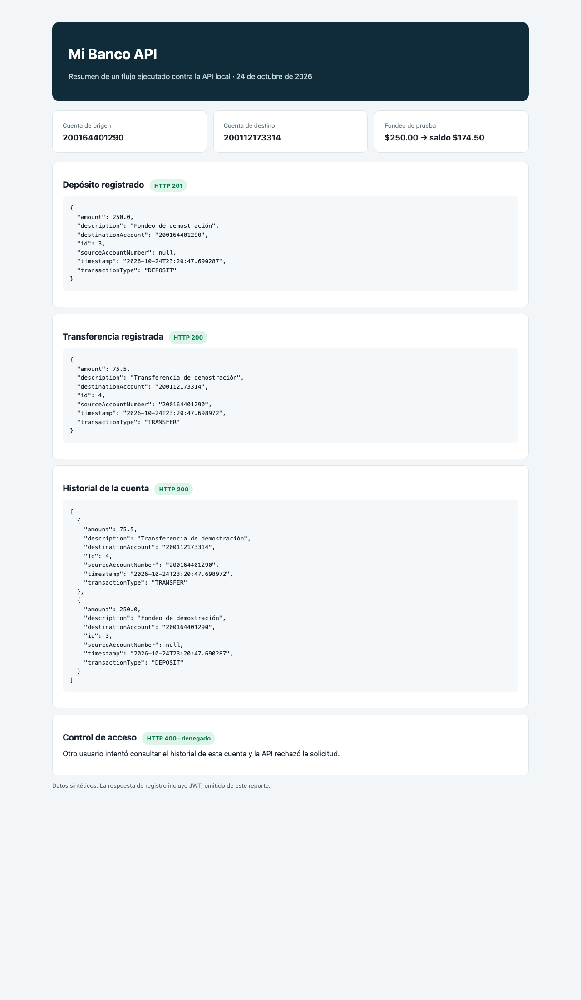

# Mi Banco API

Backend REST para practicar registro de usuarios, cuentas, autenticación JWT, depósitos de prueba y transferencias. Está construido con Java 17, Spring Boot, Spring Security, Spring Data JPA y MySQL.

## Origen y trabajo realizado

Este proyecto parte como referencia del backend público [DanielDev87/bckdbank](https://github.com/DanielDev87/bckdbank). Esta carpeta es una copia de trabajo separada; el repositorio de referencia no fue modificado.

Sobre esa base adapté la identidad y configuración para Mi Banco, y realicé estos cambios:

- Moví las clases al paquete `com.mibanco.api` y cambié el nombre del artefacto Maven.
- Separé la persistencia en la base `mi_banco` y externalicé credenciales y clave JWT mediante variables de entorno.
- Hice que las cuentas nuevas comiencen con saldo cero.
- Reemplacé `Math.random()` por `SecureRandom` al generar números de cuenta.
- Añadí bloqueo pesimista de cuentas y orden estable al adquirir bloqueos durante transferencias concurrentes.
- Añadí validación de precisión monetaria y longitud en solicitudes.
- Añadí depósitos de prueba autenticados: el usuario solo puede depositar en una cuenta propia y el movimiento queda registrado en el historial.

El endpoint de depósito **simula el fondeo para esta práctica**. No representa un ingreso de dinero real y no debe habilitarse como tal en un sistema bancario de producción.

## Funcionalidades y rutas

| Método | Ruta | Acceso | Descripción |
| --- | --- | --- | --- |
| `POST` | `/api/v1/auth/register` | Público | Registra usuario, crea cuenta de ahorros en cero y devuelve JWT. |
| `POST` | `/api/v1/auth/login` | Público | Inicia sesión y devuelve JWT. |
| `GET` | `/api/v1/accounts` | JWT | Lista las cuentas del usuario. |
| `GET` | `/api/v1/accounts/{accountNumber}` | JWT | Consulta una cuenta propia. |
| `POST` | `/api/v1/transactions/deposit` | JWT | Registra un depósito de prueba en una cuenta propia. |
| `POST` | `/api/v1/transactions/transfer` | JWT | Transfiere entre cuentas y registra el movimiento. |
| `GET` | `/api/v1/transactions/account/{accountNumber}` | JWT | Lista movimientos de una cuenta propia. |

### Ejemplo de depósito

Envía `Authorization: Bearer <token>`:

```json
{
  "accountNumber": "NUMERO_DE_CUENTA_PROPIA",
  "amount": 250.00,
  "description": "Fondeo de prueba"
}
```

### Ejemplo de transferencia

```json
{
  "sourceAccountNumber": "CUENTA_ORIGEN",
  "destinationAccountNumber": "CUENTA_DESTINO",
  "amount": 75.50,
  "description": "Pago de prueba"
}
```

El token debe pertenecer al titular de la cuenta de origen. El sistema rechaza cuentas iguales, montos menores a `0.01`, montos con más de dos decimales y saldo insuficiente.

## Requisitos

- Java 17 o superior
- Maven (incluido Maven Wrapper)
- MySQL 8 o superior

## Configuración y ejecución

La aplicación usa `http://localhost:8080`. En tu entorno actual, MySQL está configurado en el puerto `3307`, con el usuario `root` y sin contraseña; usa el comando de ejemplo de abajo para iniciarla. Las variables de entorno solo se cambian si ejecutas el proyecto en otra máquina cuya configuración de MySQL sea distinta:

| Variable | Valor por defecto | Uso |
| --- | --- | --- |
| `DB_URL` | `jdbc:mysql://localhost:3306/mi_banco?createDatabaseIfNotExist=true&useSSL=false&allowPublicKeyRetrieval=true&serverTimezone=UTC` | URL JDBC de MySQL |
| `DB_USERNAME` | `root` | Usuario de MySQL |
| `DB_PASSWORD` | vacío | Contraseña de MySQL |
| `JWT_SECRET` | clave local de desarrollo | Clave Base64 para firmar JWT; en despliegue usa una clave secreta propia de al menos 256 bits |
| `DB_SHOW_SQL` | `false` | Activa la salida SQL de Hibernate si vale `true` |

No tienes que definir estas variables si MySQL está en el puerto `3306`, acepta al usuario `root` sin contraseña y quieres usar la base `mi_banco`. Para tu instalación local, MySQL usa el puerto `3307` porque `3306` ya está ocupado; ejecuta así:

```bash
DB_URL='jdbc:mysql://localhost:3307/mi_banco?createDatabaseIfNotExist=true&useSSL=false&allowPublicKeyRetrieval=true&serverTimezone=UTC' \
DB_USERNAME=root DB_PASSWORD='' ./mvnw spring-boot:run
```

Desde esta carpeta, inicia normalmente con:

```bash
./mvnw spring-boot:run
```

Swagger UI: <http://localhost:8080/swagger-ui.html>  
OpenAPI: <http://localhost:8080/v3/api-docs>

Hibernate crea o actualiza las tablas mediante `ddl-auto: update`, adecuado para esta práctica local. Para producción se recomienda migración explícita de esquema y configuración de secretos fuera del código.

## Evidencia de ejecución

Las imágenes siguientes documentan la versión ejecutándose y un flujo real realizado contra la API local. El reporte de respuestas omite los JWT; el detalle JSON está disponible en [`docs/evidencias/flujo-api.json`](docs/evidencias/flujo-api.json). Los usuarios y movimientos del ejemplo son datos sintéticos.

**Swagger UI con las rutas de la versión:**



**Registro, depósito, transferencia, consulta de historial y rechazo de acceso a otra cuenta:**



## Verificación

Compilar sin ejecutar pruebas:

```bash
./mvnw -DskipTests package
```

## Estructura

```text
src/main/java/com/mibanco/api/
├── config/       # Seguridad, JWT y OpenAPI
├── controller/   # Endpoints REST
├── dto/          # Solicitudes y respuestas
├── entity/       # Usuarios, cuentas y movimientos
├── exception/    # Errores de dominio y respuestas HTTP
├── repository/   # Persistencia JPA
├── security/     # Filtro y emisión de JWT
└── service/      # Reglas de negocio
```
